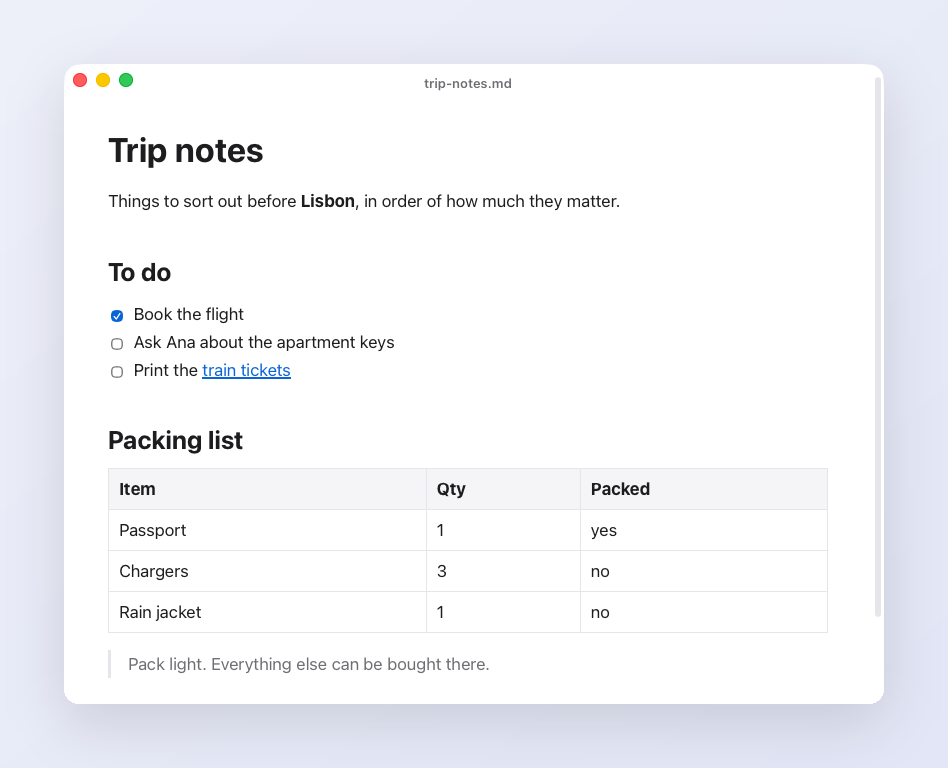

# Athens Light

<p align="center"></p>

A tiny WYSIWYG markdown editor for macOS. Open a `.md` file, edit it as rich text, and it saves back to the same file. No vaults or sync.

Website and comparison of Mac markdown editors: **[athens-light.app](https://athens-light.app)**

Athens Light is the minimalist version of [Athens](https://tryathens.com), the AI writing editor I built earlier.

Built with [Tauri](https://tauri.app) (Rust) and [Tiptap](https://tiptap.dev). The app is about 3 MB.

## Install

```sh
curl -fsSL https://athens-light.app/install.sh | sh
```

Run it again to update. Or download [Athens-Light-arm64.zip](https://github.com/moritzWa/athens-light/releases/download/latest/Athens-Light-arm64.zip) and drag the app to Applications. The app is signed and notarized by Apple. Apple silicon only.

Every push to `main` builds a signed app in GitHub Actions and replaces the files on the [latest release](https://github.com/moritzWa/athens-light/releases/tag/latest), so these links never change. The workflow notarizes and staples the app using the repository secrets `APPLE_ID`, `APPLE_APP_SPECIFIC_PASSWORD` and `APPLE_TEAM_ID`.

## Features

- Double-click a `.md` file to edit it as rich text, with markdown shortcuts (`# `, `**bold**`, `- `, and so on)
- Native macOS tabs: every file opens as a tab
- Auto-saves to the file as you type
- Reloads a file when something else changes it
- Cmd+N creates a new markdown file, Cmd+O opens one, and clicking the title renames the file
- Cmd+K copies the active file's full path to the clipboard
- Selecting text opens a compact contextual menu for formatting, links, comments, footnotes, images and tables. No toolbar stays on screen while writing. Right-click at the caret for insertion controls, or inside a table for row and column actions. Escape dismisses the menu.
- Comments appear as margin cards. Select any words (a single word is fine) and use Comment in the toolbar; the words get a highlight and the card sits beside them. Click a highlight or a card to link the two, or edit and delete from the card. Comments stay in the Markdown file, with no separate database: a comment on words is written as `<!-- comment: note -->the words<!-- /comment -->`, and plain `<!-- note -->` comments still show as cards for their paragraph.
- Footnotes show numbered references and editable notes collected at the end in first-reference order. Click a reference to jump to its note, or use Footnote in the toolbar to add one. Deleting the last reference removes the note; undo restores both. Named labels and multiline notes stay in standard Markdown. Unused definitions imported from a file stay in its source but are not shown as notes.
- Insert tables with a row/column count. Hovering a table shows a grip above each column and beside each row (click for insert, delete and remove-table actions) and `+` strips on the right and bottom edges to append a column or row. Drag a column border to resize it. Markdown has no column widths, so resized widths last only while the file is open.
- Insert images by URL, a path inside the document's folder, or local file. Chosen files are copied to an `assets` folder beside the document without overwriting existing images. Markdown keeps a relative path, not an app-specific URL.
- Local raster images and SVGs refresh automatically when another app changes or replaces them, without reopening or editing the Markdown. Referenced files are checked once a second and when the window regains focus.
- The open document reloads by itself within about a second when another app, git or an agent overwrites, replaces or recreates it. Your caret and scroll position stay put. If you have unsaved edits at that moment, autosave pauses and a bar offers Keep mine, Take theirs, or Keep both (your version is saved beside the file as `name (my edits <date time>).md`).
- Select an image and choose Copy image in the contextual toolbar to copy the bitmap to the macOS clipboard.
- Click a link to open it. Hover for a small destination preview with Copy and Edit actions.
- Cmd+S reads the document aloud with Speechify, highlighting the sentence and word being spoken. It reads the selection, or from the caret to the end, and turns on reader mode. In reader mode, hovering a sentence previews it in peach and a click reads from the start of that sentence (the caret stays where it was and links don't open), Cmd+S pauses and resumes, and Option+= and Option+- change speed (remembered, default 1.7x). Reader mode stays on after the last sentence so you can click again. Escape, the close button or any edit exits it, and then a click places the caret as usual. Option+click a word also starts reading from it outside reader mode. Code blocks, footnote bodies, URLs and long IDs are skipped, and German sentences switch to a German voice. Audio is cached, so repeating a read costs nothing. Saving is automatic, so Cmd+S no longer needs to be pressed to save (it still flushes a pending save). Speech needs a Speechify API key in `SPEECHIFY_API_KEY`, `~/Library/Application Support/com.moritz.athenslight/speechify.key`, or `~/.local/share/opencode/speechify.key`; it is never stored in the repo.
- When the open file is in a git repository and has uncommitted changes, a Commit button appears at the top right. It commits that file only, after showing an editable message. The message comes from a small model (`openai/gpt-oss-20b` on Groq) using `GROQ_API_KEY`, `~/Library/Application Support/com.moritz.athenslight/groq.key`, or the Groq key in OpenCode's `~/.local/share/opencode/auth.json`. With no key, or if the request fails, it is written locally from the diff, like "Deleted 5 words and added 6 in Pricing". Only the diff of that file is sent.
- Front matter, images, task lists and tables survive editing; files with other raw HTML open read-only
- Light and dark mode follow the system
- Remembers the last document window's position and size across launches
- Publishes the filename and file URL through macOS window metadata (`AXTitle` and `AXDocument`), so tools like Cronus can identify the active document, including after a rename

## Caveat

Your first edit to a file rewrites it in the editor's markdown style, which can change bullet characters or spacing. Opening a file without editing it never rewrites it. Files that contain raw HTML (other than comments) open read-only, because the editor cannot write it back faithfully. Comments on words stay inside one paragraph, so a selection across paragraphs comments on the part in its first paragraph. Comments do not include authors, replies or resolved states.

## Build

You need Rust, [Bun](https://bun.sh), and Xcode command line tools.

```sh
bun install
bun run build:mac
```

The app ends up in `src-tauri/target/release/bundle/macos/Athens Light.app`. Copy it to `/Applications`.

macOS builds use the project's Developer ID certificate from Keychain. Other developers can set `APPLE_SIGNING_IDENTITY` to their own certificate. The build fails if the certificate is unavailable; it must not silently fall back to ad-hoc signing for an installed app. `build:mac` also verifies the bundle's signature and stable identity. For throwaway development, use `bunx tauri dev` instead.

### Documents folder permission

macOS may ask once when a document loads images from a protected folder. Subsequent launches and signed updates keep that consent. Switching from an old ad-hoc build to the signed app may require one final approval. No Full Disk Access is needed. See [the investigation](docs/macos-file-access.md) for why folder bookmarks are not the fix for this build.

To make it the default for `.md` files, use Finder (Get Info, Open with, Change All) or [`duti`](https://github.com/moretension/duti):

```sh
duti -s com.moritz.athenslight net.daringfireball.markdown all
```

## Develop

```sh
bunx tauri dev
```

## Tests

Run regression tests with `bun test` and native image-import and file-version tests with `cargo test --lib` in `src-tauri`. `bun run test:browser` checks the toolbar, footnotes, image selection and external raster/SVG refresh in headless Chromium. Install browsers with `bunx playwright install chromium webkit`; run the same suites in WebKit with `BROWSER=webkit bun run test:browser`.

After `bun run build:mac`, `bun run test:mac-signing` changes and re-signs a temporary bundle copy, then checks that it still satisfies the original build's designated requirement. This tests privacy-identity continuity without opening an app or accessing user documents.

## License

MIT
