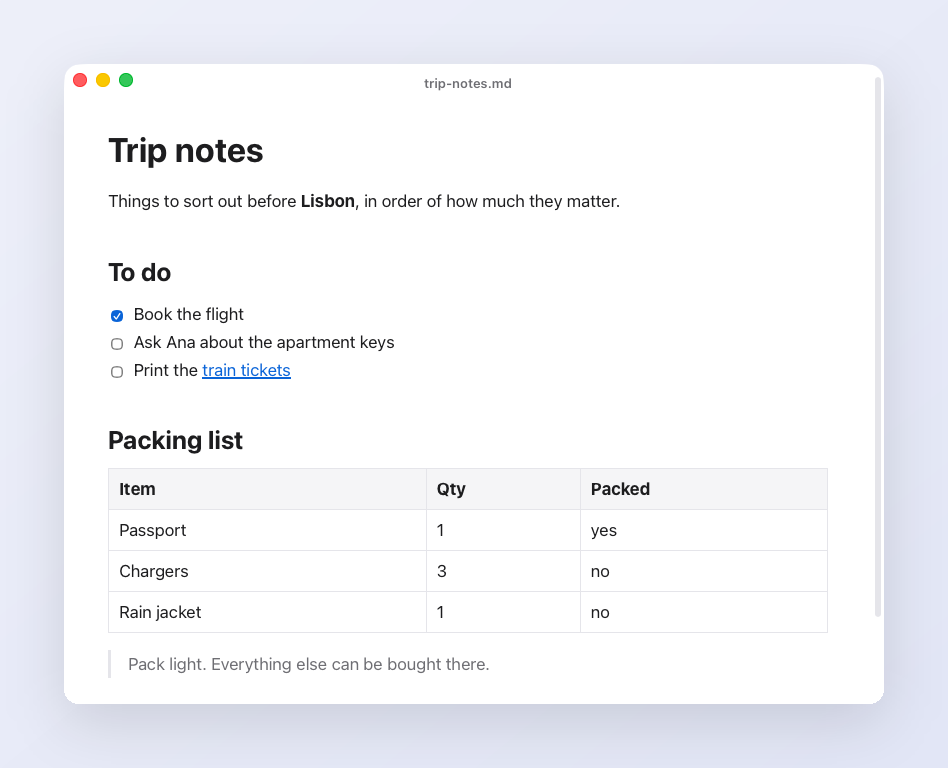

# Athens Light

<p align="center"></p>

A tiny WYSIWYG markdown editor for macOS. Open a `.md` file, edit it as rich text, and it saves back to the same file. No vaults, no sync, no toolbar.

Website and comparison of Mac markdown editors: **[athens-light.app](https://athens-light.app)**

Built with [Tauri](https://tauri.app) (Rust) and [Tiptap](https://tiptap.dev). The app is about 3 MB.

## Features

- Double-click a `.md` file to edit it as rich text, with markdown shortcuts (`# `, `**bold**`, `- `, and so on)
- Native macOS tabs: every file opens as a tab
- Auto-saves to the file as you type
- Reloads a file when something else changes it
- Cmd+N creates a new markdown file, Cmd+O opens one, and clicking the title renames the file
- Front matter, images, task lists and tables survive editing; files with raw HTML or footnotes open read-only
- Light and dark mode follow the system

## Caveat

Your first edit to a file rewrites it in the editor's markdown style, which can change bullet characters or spacing. Opening a file without editing it never rewrites it. Files that contain raw HTML or footnotes open read-only, because the editor cannot write them back faithfully.

## Build

You need Rust, [Bun](https://bun.sh), and Xcode command line tools.

```sh
bun install
bunx tauri build --bundles app
```

The app ends up in `src-tauri/target/release/bundle/macos/Athens Light.app`. Copy it to `/Applications`.

To make it the default for `.md` files, use Finder (Get Info, Open with, Change All) or [`duti`](https://github.com/moretension/duti):

```sh
duti -s com.moritz.athenslight net.daringfireball.markdown all
```

## Develop

```sh
bunx tauri dev
```

## License

MIT
